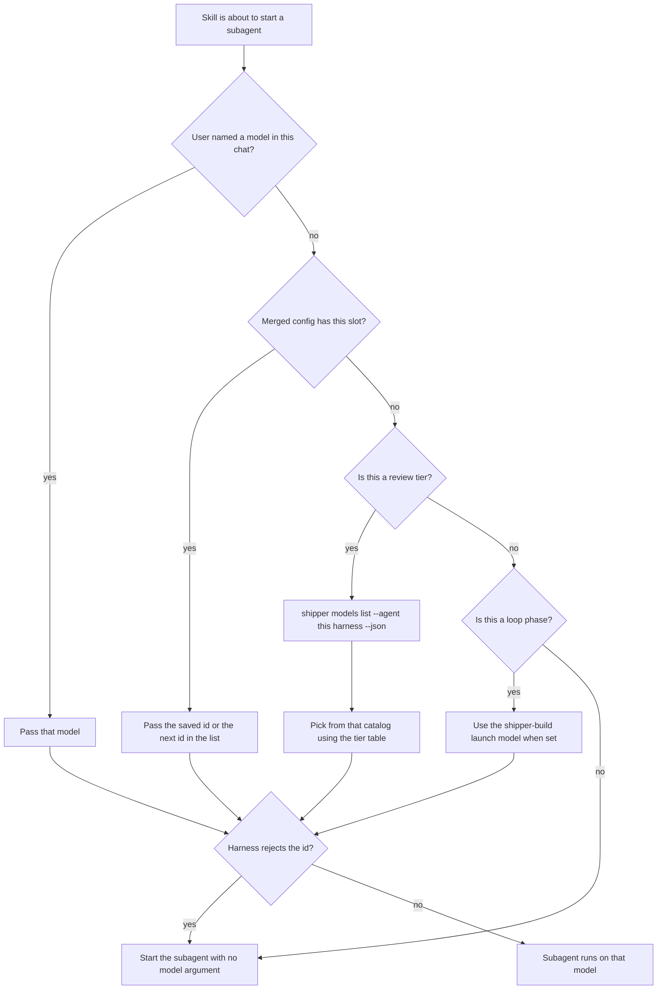

# Preferred Models for Skills and Subagents

## A: Plan Overview

Shipper already stores one model id per coding agent per skill (`models.<agent>.<skill>`), and the setup console already asks each harness for its live model list. That list never leaves the console, the review tiers described in the docs are not in the schema, and skills that spawn their own helpers have no slot separate from the model used to launch the skill itself.

This plan makes those preferences real, per harness, on the existing global, repo, and local config layers (later layer wins, field by field).

Decisions locked with the user:

- Review uses three tiers per harness. `triage` is one model id. `light` and `heavy` are ordered lists so a review can mix model families.
- The other skills keep their launch model, and the skills that spawn helpers get a separate slot for those helpers.
- Preferences live in all three layers, same as the other settings.

What a saved id means:

| Key | Who reads it | What it selects |
|-----|----------------|-----------------|
| `models.<agent>.<skill>` as a string, or `.model` inside an object | A parent skill starting that skill as a subagent | The model for the child skill. The running agent still cannot change its own model. |
| `models.<agent>.shipper-plan.research` and `models.<agent>.shipper-spike.research` | plan and spike, while gathering context | Parallel research subagents |
| `models.<agent>.shipper-bug.investigate` | shipper-bug, during diagnosis | Parallel investigation subagents |
| `models.<agent>.shipper-loop.phase` | shipper-loop | Each phase subagent. When unset, keep today's fallback: `models.<agent>.shipper-build`. |
| `models.<agent>.shipper-review.triage` | shipper-review step 3 | The one triage subagent |
| `models.<agent>.shipper-review.light` | shipper-review | Light-tier lane generalists, and fact-checks of non-security suggestions |
| `models.<agent>.shipper-review.heavy` | shipper-review | Heavy persona panels, evidence provers, fact-checks of blockers and every Security finding, and the judge |

`shipper-build` and `shipper-ship` do not spawn subagents, so they stay a single launch model. Cursor's Bugbot and Security Review stay fixed subagent types. They are not model ids.

`shipper models list` prints the models each installed harness reports, using the listers that already exist. Skills run that command when a review tier is unset. A saved id is kept even when it is absent from the live list, because lists go stale and a failed listing must not discard a config file.



## B: Related Files

| File | Role |
|------|------|
| [src/shared/config-schema.ts](/Users/mattmichel/Documents/shipper/src/shared/config-schema.ts) | Zod schema for on-disk `models`. Today every skill value is `z.string()`, and `shipper-review` is absent. |
| [src/core/config.ts](/Users/mattmichel/Documents/shipper/src/core/config.ts) | `applyModels` copies only non-empty strings for `SKILL_NAMES` into `effective.models`. |
| [src/core/config.test.ts](/Users/mattmichel/Documents/shipper/src/core/config.test.ts) | Merge tests expect `effective.models.cursor["shipper-build"]` to be a string and the source key `models.cursor.shipper-build`. |
| [src/agents/models.ts](/Users/mattmichel/Documents/shipper/src/agents/models.ts) | Live listing: Cursor `--list-models`, Claude `supportedModels()`, opencode `config.providers()`. |
| [src/agents/model-variants.ts](/Users/mattmichel/Documents/shipper/src/agents/model-variants.ts) | Groups a harness list into families for the picker. Add vendor detection here. |
| [src/index.ts](/Users/mattmichel/Documents/shipper/src/index.ts) | Commander setup. `shipper config` prints `sources` via `valueAt` and `formatConfigValue`. Add `shipper models list` beside it. |
| [src/web/config-draft.ts](/Users/mattmichel/Documents/shipper/src/web/config-draft.ts) | `modelValue` / `setModel` read and write a single string per skill. |
| [src/web/config-draft.test.ts](/Users/mattmichel/Documents/shipper/src/web/config-draft.test.ts) | Covers `setModel` keeping sibling skills. |
| [src/web/components/config-form.tsx](/Users/mattmichel/Documents/shipper/src/web/components/config-form.tsx) | Models fieldset: one row per `SKILL_NAMES` entry, Choose opens `ModelPicker`. |
| [src/web/components/config-section.tsx](/Users/mattmichel/Documents/shipper/src/web/components/config-section.tsx) | Effective tab prints `models.<agent>.<skill>` only when the value is a string. |
| [src/web/components/model-picker.tsx](/Users/mattmichel/Documents/shipper/src/web/components/model-picker.tsx) | Single-select family then variant. Reuse it; do not add a second picker. |
| [src/web/styles.css](/Users/mattmichel/Documents/shipper/src/web/styles.css) | `.model-row` is a three-column grid (`9.5rem`, value, buttons). Widen the label column for the new row names. |
| [skills/CONFIG.md](/Users/mattmichel/Documents/shipper/skills/CONFIG.md) | Canonical config contract. Copies under each skill folder must stay byte-identical. |
| [skills/shipper-plan/SKILL.md](/Users/mattmichel/Documents/shipper/skills/shipper-plan/SKILL.md) | Tells the planner to use parallel research subagents, with no model. |
| [skills/shipper-spike/PLAN.md](/Users/mattmichel/Documents/shipper/skills/shipper-spike/PLAN.md) | Same research-subagent sentence as plan. |
| [skills/shipper-bug/FIX.md](/Users/mattmichel/Documents/shipper/skills/shipper-bug/FIX.md) | Tells the bug skill to use parallel investigation subagents, with no model. |
| [skills/shipper-loop/SKILL.md](/Users/mattmichel/Documents/shipper/skills/shipper-loop/SKILL.md) | Line 43 passes `models.<agent>.shipper-build` to every phase subagent. |
| [skills/shipper-review/SKILL.md](/Users/mattmichel/Documents/shipper/skills/shipper-review/SKILL.md) | Model tiers table and the "resolve tiers" paragraph. Steps 3 through 7 launch the subagents. |
| [README.md](/Users/mattmichel/Documents/shipper/README.md) | Config key table, around the `models.<agent>.<skill-name>` row. |
| [src/core/skills-config.test.ts](/Users/mattmichel/Documents/shipper/src/core/skills-config.test.ts) | Fails unless every skill `CONFIG.md` equals `skills/CONFIG.md`. |

## C: Existing Code to Utilize

Live model listing is already per harness. Do not add a second discovery path.

```136:157:src/agents/models.ts
export async function listModels(kind: AgentKind): Promise<ModelOption[]> {
  const cached = cache.get(kind);
  if (cached) {
    return cached;
  }

  let models: ModelOption[];
  switch (kind) {
    case "cursor":
      models = await listCursorModels();
      break;
    case "claude":
      models = await listClaudeModels();
      break;
    case "opencode":
      models = await listOpencodeModels();
      break;
  }

  cache.set(kind, models);
  return models;
}
```

Cursor runs `<detected cursor binary> --list-models` and parses `slug - display name` lines in `parseCursorModelList`. Claude uses the Agent SDK `supportedModels()`. OpenCode starts a short-lived local server and reads `config.providers()`, storing ids as `providerId/modelId`. `listModels` caches for the process. The CLI should call `clearModelListCache()` only in tests, not before a user-facing list.

The setup console already sends `{ type: "list-models", agent }` and receives families from `groupModelFamilies`. The form's `chooseModel` loads that cache once per agent. New rows call the same `onListModels(agent)`.

Config merge is field-by-field for `git` and whole-value replacement for arrays (`search.extraDirs`). Match that: a later layer replaces only the model fields it sets, and a later `light` or `heavy` array replaces the whole list.

`shipper config` already prints merged config. Once `sources` contains the new leaf keys, `valueAt` plus `formatConfigValue` will print them. `formatConfigValue` JSON-encodes anything that is not a string, which is the right display for a model list. No new printer is required.

`perSkill()` in `config-schema.ts` is also the instructions schema. Do not add `shipper-review` or role objects to `perSkill()`. Add them only on the models schema.

## D: Codebase Conventions to Follow

- Bun and the scripts in `package.json`: `bun run typecheck`, `bun run lint`, `bun run test`. Tests are Vitest.
- Zod 4 schemas in `src/shared/config-schema.ts`. Use `z.looseObject` so unknown keys survive on disk. One invalid known value drops the entire config file (`schemaErrorMessage` in `src/core/config.ts`).
- `SKILL_NAMES` stays the six launchable skills. `shipper-review` stays outside that tuple. Instructions, skill install, and the instructions form must not grow a review row.
- Effective config is what `shipper config` and the Effective tab read. The draft in the form is the raw layer object. Update both.
- Copy `skills/CONFIG.md` byte-for-byte into `skills/shipper-plan/`, `skills/shipper-build/`, `skills/shipper-loop/`, `skills/shipper-spike/`, `skills/shipper-ship/`, `skills/shipper-bug/`, and `skills/shipper-review/`. The test compares buffers.
- Setup-console components use the existing button classes (`secondary-button`, `button-row`) and the existing modal. A list row is several `.model-row` lines, not a new widget library.
- Full-path links in this plan are for the implementer. User-facing docs keep the repo's existing relative style.

## E: Gotchas

- A string is still valid for the six skills. `models.cursor.shipper-build: "composer-2.5"` must keep loading. Writing a role changes that skill's value to an object, and the launch id moves to `model`. Readers accept both. The form writes a string when the only set field is the launch model, and an object once any role is set.
- `shipper-review` as a string is invalid and drops that whole config file. The schema error should name `models.<agent>.shipper-review`. Do not coerce a string into `heavy` or `triage`.
- Empty strings, whitespace-only ids, and empty arrays are invalid. The form omits a key instead of saving `""` or `[]`.
- Duplicate ids inside `light` or `heavy` are removed during merge, first occurrence wins. The form refuses to append an id that is already in the list.
- A later layer cannot clear a lower layer's field by omitting it. Clear on the layer that set it, matching git fields. A string on a higher layer replaces only the launch model. It leaves roles set by a lower layer in place.
- Saved ids are not checked against `listModels`. A model renamed by the vendor, or a harness that is offline, must not invalidate the file. The picker only offers live ids. Hand-edited JSON may contain any non-empty string.
- OpenCode ids contain a slash (`provider/model`). Split on the first slash only where vendor detection needs the provider. Store the full id.
- `applyModels` must ignore role keys that do not belong to that skill (`research` on `shipper-build`, `model` on `shipper-review`). Leave them in the parsed layer file via `looseObject`, and leave them out of `effective`.
- Changing `effective.models[agent][skill]` from a string to `{ model, ...roles }` breaks current tests and the Effective tab. Update both in the same phase. `shipper config` will print `models.cursor.shipper-build.model` instead of `models.cursor.shipper-build`.
- Loop's fallback to the build launch model is skill behavior. Do not copy the build id into `phase` during merge, or the source layer will be wrong.
- Review's "two families" rule is a warning in the console and a hard rule in the skill text. Saving a one-family list is allowed, because Claude Code often has a single vendor. The skill records that in coverage notes.
- `listModels` throws when a harness is missing or returns nothing. The CLI prints that error to stderr and still prints the harnesses that succeeded.
- The parent agent cannot switch its own model. Do not tell plan, bug, or review to relaunch themselves.

## Plan

## Phase 1: Config schema and merge

- Teach the config files to store launch models, child-role models, and review tiers, and to merge them field by field.
- Outcomes: existing string values still load; new objects load; a bad review value rejects that file; `shipper config` prints the new leaf keys; unit tests cover merge, dedupe, and field independence.

### Section 1: On-disk schema

- Overview: widen `modelsSchema` in [src/shared/config-schema.ts](/Users/mattmichel/Documents/shipper/src/shared/config-schema.ts). Leave `perSkill()` and `SKILL_NAMES` as they are.

- [x] Add `modelIdSchema = z.string().trim().min(1)`.
- [x] Add a launch-or-roles union used by the six skills:

```ts
const skillModelSchema = z.union([
  modelIdSchema,
  z.looseObject({
    model: modelIdSchema.optional(),
    research: modelIdSchema.optional(),
    investigate: modelIdSchema.optional(),
    phase: modelIdSchema.optional(),
  }),
]);
```

- [x] Add the review object. `light` and `heavy` accept one id or a non-empty array of ids:

```ts
const modelListSchema = z.union([modelIdSchema, z.array(modelIdSchema).min(1)]);

const reviewModelSchema = z.looseObject({
  triage: modelIdSchema.optional(),
  light: modelListSchema.optional(),
  heavy: modelListSchema.optional(),
});
```

- [x] Replace `modelsSchema` with a `looseObject` whose `claude`, `cursor`, and `opencode` values are each a `looseObject` of the six skills (`skillModelSchema.optional()`) plus `"shipper-review": reviewModelSchema.optional()`.
- [x] Export types the web form and tests can share:

```ts
export type SkillModelConfig = {
  model?: string;
  research?: string;
  investigate?: string;
  phase?: string;
};

export type ReviewModelConfig = {
  triage?: string;
  light?: string[];
  heavy?: string[];
};
```

- [x] Change `EffectiveConfig["models"]` to `Partial<Record<AgentKind, Partial<Record<SkillName, SkillModelConfig>> & { "shipper-review"?: ReviewModelConfig }>>`. Every stored skill, including one that was a string on disk, is normalized to `SkillModelConfig` in the effective object. Launch id lives on `model`.

### Section 2: Merge

- Overview: replace the string-only loop in `applyModels` in [src/core/config.ts](/Users/mattmichel/Documents/shipper/src/core/config.ts).

- [x] For each agent, read each of the six skills. A non-empty string sets `model` and records source `models.<agent>.<skill>.model` on the current layer. An object sets only the keys that are present and non-empty. Source keys are `models.<agent>.<skill>.model`, `.research`, `.investigate`, and `.phase`.
- [x] Copy `research` only for `shipper-plan` and `shipper-spike`, `investigate` only for `shipper-bug`, and `phase` only for `shipper-loop`. Drop the other role keys from the effective object.
- [x] For `shipper-review`, copy `triage` when it is a non-empty string. Normalize `light` and `heavy` with a helper `normalizeModelList(value: unknown): string[] | undefined`: a string becomes a one-element list; an array keeps order, trims, drops empties, and drops duplicates. A missing or empty result leaves the lower layer's list in place. Source keys are `models.<agent>.shipper-review.triage`, `.light`, and `.heavy`.
- [x] A higher layer that sets one field leaves the other fields from lower layers. Example: repo `{ "shipper-plan": { "model": "big", "research": "mid" } }` plus local `{ "shipper-plan": "local-big" }` yields `{ model: "local-big", research: "mid" }` with sources local and repo respectively.
- [x] Do not invent a source key for the parent object. `orderedSourceKeys` in [src/index.ts](/Users/mattmichel/Documents/shipper/src/index.ts) already appends unknown source keys alphabetically, and `valueAt` walks dots, so leaf keys print on their own.

### Section 3: Tests

- Overview: update [src/core/config.test.ts](/Users/mattmichel/Documents/shipper/src/core/config.test.ts) and add cases. Existing expectations that compare a skill value to a string become `{ model: "<id>" }`, and source keys gain the `.model` suffix.

- [x] Keep the current precedence test, updated to the object shape: local `shipper-build` string wins over repo and global.
- [x] Add a field-independence test for the example in Section 2.
- [x] Add a review test: global sets `triage` and `heavy: ["a", "b"]`; repo sets `heavy: "frontier"` (a string); local sets `light: ["fast-a", "fast-a", "fast-b"]`. Effective triage comes from global, heavy is `["frontier"]` from repo, light is `["fast-a", "fast-b"]` from local.
- [x] Add a rejection test: `models.cursor["shipper-review"] = "opus"` makes `layers.local.error` (or whichever layer) non-null and leaves `effective.models` without that layer's other keys.
- [x] Add a test that `research` on `shipper-build` stays in `layers.repo.value` and is absent from `effective.models.cursor["shipper-build"]`.

### Completion Notes

- Effective skill values are always `SkillModelConfig`. A string on disk becomes `{ model }`. Source keys are leaves only (`models.<agent>.<skill>.model`, plus `.research`, `.investigate`, `.phase`, and `models.<agent>.shipper-review.triage|light|heavy`). There is no source key for the parent skill or review object. `shipper config` already prints those leaves through `orderedSourceKeys` and `valueAt`; lists JSON-encode.
- A later string replaces only `model`. It leaves roles set by a lower layer. A later `light` or `heavy` replaces that whole list. Omitting a field does not clear a lower layer. Loop does not copy the build launch id into `phase`.
- `normalizeModelList` is private in `src/core/config.ts`. Phase 3 should export it from `config-schema.ts` so the form and `applyModels` share one helper.
- A string `shipper-review` drops the whole file. Zod's message names the path as `models.<agent>["shipper-review"]` (bracket form, because of the hyphen).
- `perSkill()` and `SKILL_NAMES` are unchanged, so instructions still have no review row. `research` on `shipper-build` and `model` on `shipper-review` stay in the parsed layer via `looseObject` and are left out of `effective`.
- The Effective tab reads `models.<agent>.<skill>.model` only, so typecheck still passes after the value became an object. Role rows, review rows, and the form are still Phase 3.
- Verification: `bun run typecheck` passed. `bun run test src/core/config.test.ts` passed, 22 tests. Changes are uncommitted on `main`.

## Phase 2: `shipper models list`

- Give humans and skills one command that prints the live catalog for each harness.
- Outcomes: `shipper models list` and `shipper models list --json` work for detected agents; `--agent` limits the run to one harness; unit tests cover formatting without spawning a harness.

### Section 1: Formatter

- Overview: put pure formatting next to the listers so tests do not boot Commander.

- [x] In [src/agents/models.ts](/Users/mattmichel/Documents/shipper/src/agents/models.ts), add `formatModelCatalog(catalog: Partial<Record<AgentKind, ModelOption[]>>): string`. For each agent in `AGENT_KINDS` order, skip missing keys. Print the agent name, then one line per model: two spaces, id, tab, label. Print nothing for an empty catalog.
- [x] Add `modelCatalogJson(catalog): string` that returns pretty JSON `{ "agents": { "<kind>": [{ "id", "label" }] } }` with the same agent order and no extra fields.
- [x] Extend [src/agents/models.test.ts](/Users/mattmichel/Documents/shipper/src/agents/models.test.ts) with a catalog that includes an opencode id `anthropic/claude-sonnet` and asserts the text and JSON shapes.

### Section 2: Command

- Overview: register the command in [src/index.ts](/Users/mattmichel/Documents/shipper/src/index.ts) next to `config`.

- [x] `program.command("models").description("list models available to each coding agent")` with subcommand `list`.
- [x] Options: `--agent <kind>` limited to `claude`, `cursor`, `opencode`, and `--json`.
- [x] With `--agent`, call `listModels` for that kind. On throw, print the error to stderr and exit 1. On success, print text or JSON and exit 0.
- [x] Without `--agent`, call `detectAgents()`. When none are detected, print `No coding agents detected` to stderr and exit 1. Otherwise list each detected kind. Print failures to stderr as `<kind>: <message>` and still print successes. Exit 0 when at least one harness returned models. Exit 1 when every harness failed.
- [x] Do not pass `--dir` into the listers. Model catalogs are machine-wide, not per repo. The command may still accept the global `--dir` flag because Commander puts it on the root program; ignore it.

### Section 3: Vendor helper

- Overview: one function the console uses for the two-family warning. Skills keep using the vendor names already listed in the review skill (`claude`, `gpt`, `gemini`, `grok`, `composer`).

- [x] Add `modelVendor(id: string): string` to [src/agents/model-variants.ts](/Users/mattmichel/Documents/shipper/src/agents/model-variants.ts). If the id contains `/`, take the substring before the first slash as the provider, then match the provider; otherwise match the whole id. Match these prefixes, case-insensitive, against the start of that token: `claude` and `anthropic` → `claude`; `gpt`, `openai`, `o1`, `o3`, `o4` → `gpt`; `gemini` and `google` → `gemini`; `grok` and `xai` → `grok`; `composer` → `composer`. When nothing matches, return the provider token, or the id up to the first `-`.
- [x] Test `composer-2.5-fast` → `composer`, `claude-opus-5-5-high` → `claude`, `openai/gpt-5` → `gpt`, `groq/llama` → `groq`.

### Completion Notes

- `formatModelCatalog` and `modelCatalogJson` live in `src/agents/models.ts`. Agents print in `AGENT_KINDS` order (`claude`, `cursor`, `opencode`); missing keys are skipped. Text is the agent name, then `  <id>\t<label>` per model. An empty catalog is `""`. JSON is two-space `{ "agents": { "<kind>": [{ "id", "label" }] } }` with only those fields. The CLI does not clear the model-list cache.
- `shipper models list` takes `--agent` and `--json` and ignores `--dir`. An unknown agent prints `Unknown agent` plus the supported kinds and exits 1. One harness prints the thrown error on stderr and exits 1, or the catalog and exits 0. No detected agents prints `No coding agents detected` on stderr and exits 1. When several are detected, a failure is `<kind>: <message>` on stderr and successes still print. Exit 0 if any harness returned models; exit 1 with no catalog if every one failed.
- `modelVendor` is in `src/agents/model-variants.ts`. A slash uses the provider token (before the first `/`). Prefixes are case-insensitive and matched from the start of that token. If nothing matches, a provider token is returned as written (`groq/llama` → `groq`); an id with no slash is returned up to the first `-`.
- `normalizeModelList` is still private in `src/core/config.ts`. Effective skill values are still objects. No setup-console rows were added.
- Verification: `bun run typecheck` passed. `bun run test src/agents/models.test.ts src/agents/model-variants.test.ts` passed, 7 tests. `bun run src/index.ts models list --help` prints `--agent` and `--json`. Live smoke: `models list --agent cursor --json` returned 270 models with `id` and `label` only. The all-harness live check is still Phase 4. Changes are uncommitted on `main`.

## Phase 3: Setup console

- Let someone set every new slot from the Models fieldset, using the live catalog the console already fetches.
- Outcomes: each detected agent shows the existing six launch rows plus the child slots and the three review tiers; lists can be appended, reordered, and cleared; a one-family light or heavy list shows a warning and still saves; the Effective tab shows leaf keys and their source layer.

### Section 1: Draft helpers

- Overview: extend [src/web/config-draft.ts](/Users/mattmichel/Documents/shipper/src/web/config-draft.ts). Keep `setModel` working for the launch string.

- [x] Add `readSkillModel(draft, agent, skill): SkillModelConfig`. A string becomes `{ model }`. An object returns only the known keys that are non-empty strings. Anything else returns `{}`.
- [x] Add `writeSkillModel(draft, agent, skill, value: SkillModelConfig)`. When the only set field is `model`, store a string so existing files stay stable. When a role is set, store `{ model?, <role> }`. When the object is empty, delete the skill key, then the agent key, then `models`, using the same cleanup as `setModel`.
- [x] Implement `setModel` as a wrapper: read, set or delete `model`, write back. The existing test "keeps other skills when one model is cleared" must still pass.
- [x] Add `readReviewModels` / `writeReviewModels` for `triage`, `light`, and `heavy`. Normalize lists through the same dedupe helper as the server (export it from `config-schema.ts` so the form and `applyModels` share it). Omit empty fields. Delete `shipper-review` when all three are unset.
- [x] In `draftIssues`, flag a review or role value that is not a trimmed non-empty string, and a list that is empty. The save button already disables when `issues.length > 0`.
- [x] Extend [src/web/config-draft.test.ts](/Users/mattmichel/Documents/shipper/src/web/config-draft.test.ts): setting `research` turns a string launch model into `{ model, research }`; clearing `research` returns the value to a string; clearing the last review field removes `shipper-review`; appending a duplicate does not change the list.

### Section 2: Models fieldset

- Overview: extend the Models fieldset in [src/web/components/config-form.tsx](/Users/mattmichel/Documents/shipper/src/web/components/config-form.tsx). `PickerTarget` becomes `{ agent: AgentKind; slot: ModelSlot }` where `ModelSlot` names the launch skill, a role, or a review tier.

- [x] Under each detected agent, keep the six launch rows. Label them `shipper-plan`, and so on, unchanged. Hint under the legend: launch rows are the model used when another skill starts that skill; the rows below are the helpers that skill starts itself.
- [x] Add role rows, each with Choose and Clear, bound to `chooseModel`:
  - `shipper-plan research`
  - `shipper-spike research`
  - `shipper-bug investigate`
  - `shipper-loop phase`, with hint text `Falls back to the shipper-build model when unset`
- [x] Add review rows:
  - `review triage`: one id, Choose and Clear, same as a launch row.
  - `review light` and `review heavy`: show the ids in order. Each line has Move up, Move down, and Remove. An Add button opens the picker and appends. Add is a no-op when that id is already present. Hide Move up on the first row and Move down on the last.
- [x] When `light` or `heavy` has two or more ids and `modelVendor` finds fewer than two distinct vendors, render a `.field-error` that says `This list is a single model family. Review panels look for two.` Do not add it to `draftIssues`.
- [x] Widen `.model-row`'s first column in [src/web/styles.css](/Users/mattmichel/Documents/shipper/src/web/styles.css) so `shipper-loop phase` fits. Keep the existing grid.
- [x] Agents that are not detected but already have model keys stay preserved, including review objects and role objects. Extend the existing "kept when you save" sentence; do not drop unknown nested keys.

### Section 3: Effective tab

- Overview: update the model loop in `EffectivePane` in [src/web/components/config-section.tsx](/Users/mattmichel/Documents/shipper/src/web/components/config-section.tsx).

- [x] For each agent and each of the six skills, print a row for each set field: key `models.<agent>.<skill>.model` (and `.research`, `.investigate`, `.phase` when set), value the id, source from `sources[key]`.
- [x] For review, print `triage` as an id and `light` / `heavy` as a comma-separated list.
- [x] Skip unset fields. Leave the rest of the Effective tab as it is.

### Completion Notes

- `normalizeModelList` is exported from `src/shared/config-schema.ts`. `applyModels` and the setup form both use it. Merge behavior is unchanged: a string becomes one id; an array keeps order, trims, drops empties, and drops duplicates.
- The form stores a launch skill as a string when `model` is the only known field and the object has no extra keys. A role stores `{ model?, research|investigate|phase }`. Clearing the last known field removes the skill or `shipper-review`, then the agent, then `models`, matching `setModel`. Unknown nested keys stay, so a skill with extra keys remains an object even when only `model` is set. `draftIssues` blocks a role or triage value that is not a trimmed non-empty string, and an empty `light` or `heavy` list. The single-family sentence is only a `.field-error`, so a one-family list still saves. Add does not append an id already in the list. Move up is hidden on the first row and Move down on the last.
- The Effective tab prints each set leaf (`models.<agent>.<skill>.model|research|investigate|phase`, plus `shipper-review.triage` and comma-separated `light` / `heavy`) and skips unset fields. The `.model-row` label column is `14rem` so the role labels fit; the three-column grid is unchanged.
- Verification: `bun run typecheck` passed. `bun run test src/web/config-draft.test.ts src/core/config.test.ts` passed, 38 tests. On the running console, Cursor launch, research, and review triage opened the live picker. Two Claude Fable variants on light showed `This list is a single model family. Review panels look for two.` with Save enabled. After a local save, the Effective tab showed `models.cursor.shipper-plan.model`, `.research`, `models.cursor.shipper-review.triage`, and `.light` from local. That local file did not exist before the check and was deleted afterward. Changes are uncommitted on `main`.

## Phase 4: Skills, docs, and verification

- Tell each skill which slot to pass, and document the command and the on-disk shape.
- Outcomes: a skill with config set passes those ids; a review with a tier unset runs `shipper models list`; README and every `CONFIG.md` describe the same shape; typecheck, lint, and tests pass.

### Section 1: CONFIG.md and README

- Overview: edit [skills/CONFIG.md](/Users/mattmichel/Documents/shipper/skills/CONFIG.md), then copy it onto the seven skill copies. Update the models row and the Models section. Then update the matching row and the local-override example in [README.md](/Users/mattmichel/Documents/shipper/README.md).

- [x] In the key table, keep `models.<agent>.<skill-name>` as the launch model (a string, or `{ "model" }` when that skill also has a role). Add rows:

| Key | Default | Meaning |
|-----|---------|---------|
| `models.<agent>.shipper-plan.research` | none | Research subagents while planning |
| `models.<agent>.shipper-spike.research` | none | Research subagents while planning a spike |
| `models.<agent>.shipper-bug.investigate` | none | Investigation subagents while diagnosing a bug |
| `models.<agent>.shipper-loop.phase` | falls back to `models.<agent>.shipper-build` | Model for each phase subagent |
| `models.<agent>.shipper-review.triage` | none | One model id for the triage subagent |
| `models.<agent>.shipper-review.light` | none | Ordered list of model ids for light-tier reviewers |
| `models.<agent>.shipper-review.heavy` | none | Ordered list of model ids for heavy-tier reviewers |

- [x] Replace the Models paragraph so it states: you cannot change your own model; pass `model` when starting another Shipper skill; pass the role or tier key when starting that skill's own helpers; a list is walked in order, round-robin, so the user can alternate families; if the subagent tool rejects an id, retry that subagent once without a model and say so; `shipper models list --agent <claude|cursor|opencode> --json` prints `{ "agents": { "<kind>": [{ "id", "label" }] } }`; when a review tier is unset, run that command and choose from it (fastest available for triage, fast models from two vendors for light, frontier models from two vendors for heavy); when the command fails, keep today's behavior and record it in the review coverage notes. `shipper-build` and `shipper-ship` have no child slot.
- [x] In the README local-override example, add a cursor block that shows a string launch model, a plan object with `model` and `research`, and a review object with `triage`, `light`, and `heavy`. Mention `shipper models list` next to the existing `shipper config` sentence.
- [x] Copy the canonical `CONFIG.md` into the seven skill directories. `src/core/skills-config.test.ts` is the check.

### Section 2: Skill behavior

- Overview: short, concrete edits. Do not restructure the skills.

- [x] [skills/shipper-plan/SKILL.md](/Users/mattmichel/Documents/shipper/skills/shipper-plan/SKILL.md), in the context-gathering paragraph: when launching research subagents, pass `models.<your agent>.shipper-plan.research` when it is set.
- [x] [skills/shipper-spike/PLAN.md](/Users/mattmichel/Documents/shipper/skills/shipper-spike/PLAN.md): the same sentence for `models.<your agent>.shipper-spike.research`.
- [x] [skills/shipper-bug/FIX.md](/Users/mattmichel/Documents/shipper/skills/shipper-bug/FIX.md): when launching investigation subagents, pass `models.<your agent>.shipper-bug.investigate` when it is set.
- [x] [skills/shipper-loop/SKILL.md](/Users/mattmichel/Documents/shipper/skills/shipper-loop/SKILL.md) step 3 item 1: start each phase subagent with `models.<your agent>.shipper-loop.phase` when set, otherwise with `models.<your agent>.shipper-build` when set. The retry subagents in step 4 use the same model.
- [x] [skills/shipper-review/SKILL.md](/Users/mattmichel/Documents/shipper/skills/shipper-review/SKILL.md) Model tiers section: replace the "Resolve tiers..." paragraph with the config keys and the `shipper models list` fallback from Section 1. Then bind the steps:
  - Step 3 uses `triage`.
  - Light-tier generalists round-robin `light`.
  - Heavy personas, provers, and the judge round-robin `heavy`. Alternate families by walking the saved list in order.
  - A fact-checker uses the tier the finding belongs to (`heavy` for blockers and every Security finding, `light` otherwise) and picks the next id in that list whose `modelVendor` differs from the author's family. When the list has no other family, say so in coverage notes.
  - The Cursor `bugbot` and `security-review` launches stay word for word.

### Section 3: Verification

- [x] `bun run typecheck`
- [x] `bun run lint`
- [x] `bun run test`
- [x] `bun run src/index.ts models list --help` prints the agent and json flags.
- [x] With at least one harness installed, `bun run src/index.ts models list --json` prints `agents` and non-empty `id` / `label` pairs. If no harness is available in the environment, record that in Completion Notes and skip the live call.
- [x] Leave Completion Notes on this phase: the effective source-key rename (`models.<agent>.<skill>` to `models.<agent>.<skill>.model`), and whether a live `models list` was run.

### Completion Notes

- Effective source keys are leaves. The old bare `models.<agent>.<skill>` string is now `models.<agent>.<skill>.model` (a string on disk still merges into that leaf). Role and review leaves are `.research`, `.investigate`, `.phase`, and `models.<agent>.shipper-review.triage`, `.light`, and `.heavy`. There is no source key for the parent skill or review object.
- A live `bun run src/index.ts models list --json` was run. It exited 0 and printed `agents` for claude, cursor, and opencode, each with non-empty `id` / `label` pairs. `models list --help` prints `--agent` and `--json`.
- `skills/CONFIG.md` is canonical and was copied byte-for-byte into shipper-plan, shipper-build, shipper-loop, shipper-spike, shipper-ship, shipper-bug, and shipper-review. Skills pass the role or tier when they launch their own helpers. Loop uses `shipper-loop.phase` when set, otherwise the `shipper-build` launch model, including the Step 3 retry subagents and the Step 4 completion subagent. An unset review tier falls back to `shipper models list`.
- Verification: `bun run typecheck` passed. `bun run test` passed, 249 tests. `bun run lint` failed on a pre-existing unused import in `src/core/update-check.test.ts` (`getUpdateCheckState`). That file has no working-tree diff; its last commit is `2c9f9cb`. This phase did not change it. Changes are uncommitted on `main`. Committing was disabled for this run, so `phase_commits` is unset and there is no completion commit.
